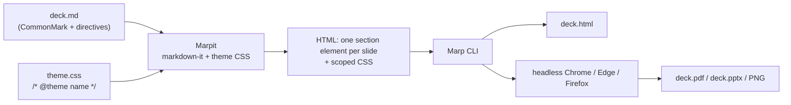

Marp is a converter that turns a Markdown file into a slide deck. A `---` starts a new slide, a few YAML lines at the top pick a theme, and the output is HTML, PDF, or PowerPoint. That's the whole pitch, and it's enough for my slides to live in git next to the runbooks and the code they talk about.

## Why slides in Markdown at all

A deck in Keynote or Google Slides is a binary blob that nobody can diff. For a talk you give once that's fine. For the decks I keep coming back to, an onboarding walkthrough, an incident review template, the same architecture overview updated every quarter, it isn't.

A Marp deck is one Markdown file where every `---` is a slide boundary, so a pull request diff reads as "slide seven changed" and `git blame` on a bullet tells you who added it and when. Code on a slide is a fenced block rather than a screenshot, so it's the snippet from the repo and it goes through the same Markdown linting as the README. You write it in whatever editor you already write everything else in.

The usual objection is that you give up layout control. You give up some. What you get back is a theme that's plain CSS, which turns out to be a better deal than it sounds, and most of this post is about that trade.

## Where Marp came from

The original Marp was an Electron desktop app by Yuki Hattori, published from the `yhatt/marp` repo with the first tags landing in May 2016: a live-preview editor with PDF export. Maintenance stopped in 2017, and the repo was archived in September 2019 with a blunt closing note: a security report had shown that opening a malicious Markdown file could execute arbitrary code, so stop using it and move to "Marp Next".

Marp Next is what everyone means by Marp today, and it's a rewrite into layers rather than a single app:

- **Marpit** is the base framework, with a first changelog entry in March 2018. It's deliberately small: Markdown plus a CSS theme in, HTML and CSS out, with a plugin system and nothing else. It doesn't even ship a theme.
- **Marp Core** sits on Marpit and adds the practical bits: three built-in themes, emoji, math, auto-scaling, and safer HTML handling. v1.0.0 came in January 2020. Every official Marp tool uses Marp Core as its engine.
- **Marp CLI** is the converter, with tags going back to August 2018.
- **Marp for VS Code** started in February 2019. It's a preview and export extension, and it's what replaced the desktop app for most people.

The split matters because it explains a lot of behaviour. When a feature says "only works in inline SVG mode" or "the app must support this attribute", that's Marpit talking: it produces markup and leaves presentation behaviour to whatever consumes it.

## A complete deck in one file

Here's a small but complete deck.

```markdown
---
marp: true
theme: default
paginate: true
header: "Platform team"
footer: "Internal, do not distribute"
---

<!-- _paginate: false -->
<!-- _class: invert -->

# On-call handover

What changed this week, and what's still on fire

---

## Things that paged

- Disk pressure on the metrics nodes
- Cert renewal failed for the staging ingress

---

<!-- _backgroundColor: #fff8e1 -->

## Still open

* The disk alert has no runbook yet
* Nobody owns the staging cert

---


## Next week

Add the runbook, assign the cert, close this out.
```

The front-matter is YAML. `marp: true` tells the VS Code extension to treat this file as a deck instead of a normal Markdown document; the CLI converts whatever you hand it and doesn't need it. `---` on its own line starts a new slide. Everything else is a directive or an image with a special alt text.

## Directives: global, local, and the underscore

Directives are the configuration layer. You write them in the front-matter or in an HTML comment anywhere in the deck, and they're parsed as YAML.

**Global directives** apply to the whole deck. Marpit defines four: `theme`, `style` (extra CSS), `headingDivider` (start a new slide at every heading of a given level), and `lang`. Marp Core adds `size` (`16:9` or `4:3` with the built-in themes) and `math` (`katex` or `mathjax`). If you set one twice, the last one wins.

**Local directives** apply to a slide and carry forward to every slide after it. `paginate`, `header`, `footer`, `class`, `color`, `backgroundColor`, `backgroundImage`, and the rest of the `background*` family are all local.

The carry-forward is the part that catches people. Set `header: "Platform team"` on slide three and slides four through twenty get it too. That's usually what you want, which is why the front-matter is the normal place for it.

When you want a directive on one slide only, prefix it with an underscore. `<!-- _paginate: false -->` hides the page number on that slide and nowhere else; that's how the title slide above skips pagination and gets the inverted colour scheme while the rest of the deck stays normal. `paginate` also takes `hold` (show the number but don't increment) and `skip` (neither), for appendix or section-divider slides.

`header` and `footer` accept inline Markdown and inline images, so a logo in the footer is `footer: " Platform team"`. They don't accept `![bg]`.

## What Marpit actually produces

Under the hood Marpit is a markdown-it pipeline. It splits the document on horizontal rules, renders each piece, and wraps it in a `<section>`. Directives become attributes and classes on that section. The theme CSS is rewritten so that every selector is scoped to the slide container, which is why a theme can say `h1 { ... }` without leaking into the page around it.



Each section is sized by the theme. The default is 1280x720 px, set with `width` and `height` on `section` in absolute units, and that same size becomes the PDF page size.

A fixed-size slide still has to fit a browser window of any size, and Marpit manages that without JavaScript. With inline SVG mode on, which Marp Core enables, each section is wrapped like this:

```html
<svg data-marpit-svg viewBox="0 0 1280 720">
  <foreignObject width="1280" height="720">
    <section>...</section>
  </foreignObject>
</svg>
```

The `viewBox` fixes the slide's coordinate system, the SVG is sized to the viewport with CSS, and the browser scales the whole thing. Marpit calls this mode experimental because WebKit has a long-standing bug scaling HTML inside `foreignObject`, and leaves it off by default. Marp Core turns it on by default, and a few features depend on it: multiple and split backgrounds, and the auto-scaling of code blocks. If you ever build on raw Marpit and `![bg right]` does nothing, check that option first.

## Rendering with Marp CLI

Marp CLI is a Node package. The one-liner is:

```bash
npx @marp-team/marp-cli@latest deck.md
```

With no flags you get `deck.html`, with the slides, the theme, and a small presentation runtime (arrow keys, presenter view). The other formats are flags: `--pdf`, `--pptx`, `--images png` for every slide as an image, `--image png` for just the first. Naming the output with `-o deck.pdf` does the same thing as the flag.

Everything except HTML needs a browser. Marp CLI drives a headless Google Chrome, Microsoft Edge, or Firefox, and you have to have one installed. `--browser` picks which (`auto`, the default, tries `chrome,edge,firefox` in that order), and `--browser-path` points at a specific binary, which is how you use Chromium, Brave, or anything else Chromium-flavoured. The browser is the renderer: PDF is the browser's print-to-PDF, images are screenshots. That's also why the PDF looks exactly like the HTML. There's no second layout engine.

A few flags worth knowing before you need them:

- `--allow-local-files`. The browser-based conversion blocks local file access by default, so a deck that references `./img/dashboard.png` renders with a missing image and a warning. The README marks the flag as not secure and says to use it only on Markdown you trust: you're letting an HTML document read your disk.
- `--pdf-notes` adds presenter notes as PDF annotations. `--pdf-outlines` adds bookmarks from the slide pages and headings.
- `--watch` (`-w`) re-renders on save and reloads the open HTML. `--server` (`-s`) serves a directory over HTTP instead of writing files, and you pick the format with a query string (`?pdf`). `--preview` (`-p`) opens a window with watch mode on.
- `--theme` overrides the theme by name or CSS file, `--theme-set` registers extra theme files or a whole directory. More on those below.

If you don't want Chrome on the machine, the official image bundles Chromium:

```bash
docker run --rm --init -v "$PWD":/home/marp/app/ -e LANG=$LANG marpteam/marp-cli deck.md --pdf
```

The image is `marpteam/marp-cli` on Docker Hub and `ghcr.io/marp-team/marp-cli` on GHCR. The mount target is `/home/marp/app/`, and `LANG` is passed through so fonts and locale behave.

One thing to set expectations on: **PPTX export is not an editable PowerPoint.** The README says a created PPTX "includes rendered Marp slide pages", and the editable-export section is more direct: the normal output "usually consists of pre-rendered background images". Each slide is a picture of the slide. It opens in PowerPoint and presents fine, but nobody is going to fix a typo in it. `--pptx-editable` is the experimental alternative. It needs LibreOffice Impress installed alongside the browser, drops presenter notes, and the README warns it may produce incomplete results with complex themes like `gaia`. If someone asks for "the PPTX so I can edit it", send them the Markdown.

## Images, layouts, and the alt text

Marpit overloads the alt text of a Markdown image. Keywords in there control size, filters, and backgrounds.

```markdown
                 <!-- width 300px -->
  <!-- any CSS length except vw/vh -->
                <!-- CSS filter -->
  <!-- filters stack -->
```

The filters are the CSS filter functions, `blur` through `sepia`. Omit the argument and you get a default.

Add `bg` and the image becomes the slide background instead of an inline element:

```markdown
               <!-- cover, the default -->
     <!-- fit inside, no cropping -->

```

Two `![bg]` images on one slide tile side by side; add `vertical` to stack them. `![bg left]` or `![bg right]` reserves half the slide for the image and squeezes the content into the other half, and `![bg right:40%]` sets the split. One line, and you have the "screenshot on one side, bullets on the other" slide without touching CSS. The simple background ignores filters; the multiple and split ones apply them.

Marp Core adds two more things at this level. `# <!-- fit --> Some long title` scales a heading to the slide width, which is the fix for a title slide where the text wraps. And code blocks auto-scale horizontally to fit, so a wide snippet shrinks rather than overflowing. Horizontally only: a tall block still runs off the bottom.

Fragmented lists hide in the bullet character. A list written with `*` is revealed one item at a time in the HTML presentation; one written with `-` appears all at once. Same for ordered lists: `1)` fragments, `1.` doesn't. In the deck above, "Things that paged" lands in one go and "Still open" builds up item by item. Marpit only emits a `data-marpit-fragment` attribute; the HTML runtime interprets it, so in the PDF both are plain lists.

## Themes are plain CSS

A Marp theme is a CSS file with one required comment:

```css
/* @theme sre */

@import 'default';

section {
  font-family: "Inter", sans-serif;
  padding: 60px;
}

section.lead {
  display: flex;
  flex-direction: column;
  justify-content: center;
  text-align: center;
}

section::after {
  content: attr(data-marpit-pagination) " / " attr(data-marpit-pagination-total);
  font-size: 14px;
}

header, footer {
  position: absolute;
  font-size: 14px;
  color: #666;
}
header { top: 20px; left: 60px; }
footer { bottom: 20px; left: 60px; }
```

`@theme` is how Marpit registers the name you then use in `theme: sre`. The file name doesn't matter; the comment does. `@import 'default'` pulls in a built-in theme so you only override what you care about. Marp Core ships three: `default` (GitHub Markdown look), `gaia`, and `uncover`. All three support `class: invert`; `gaia` also has `lead` (centred content, for title slides) and `gaia`.

`section` is the slide. `section::after` is where the page number goes, and the `content` has to include `attr(data-marpit-pagination)` or Marpit drops the declaration. Marpit gives `header` and `footer` no styling of their own, but `default` does, so the rules above are overriding its positions rather than filling a gap.

Look at the `section.lead` rule above. `class` is a local directive, so `<!-- _class: lead -->` applies that layout to one slide, and `class: lead` in the front-matter applies it everywhere. You can stack them: `<!-- _class: lead invert -->`. Define a handful of layout classes in the theme (`lead`, `two-col`, `quote`, whatever your decks keep needing) and a slide picks one with a comment. That's the whole "reusable component" story: a CSS class and a one-line directive, no templating.

For a one-off tweak, Markdown can carry CSS directly. A `<style>` block anywhere in the deck is merged into the theme and doesn't appear in the output. `<style scoped>` applies to the slide it's on and nothing else:

```markdown
---

<style scoped>
section { font-size: 20px; }
</style>

## The dense slide everyone warned you about
```

The rule I use: if a `<style>` block shows up in a second deck, it moves into the theme.

## One theme, many decks

Here's the layout that has kept my decks from turning into a pile of copy-pasted CSS:

```
talks/
├── .marprc.yml
├── themes/
│   └── sre.css
├── assets/
│   └── logo.svg
├── oncall-handover/
│   ├── deck.md
│   └── img/
└── postmortem-template/
    ├── deck.md
    └── img/
```

One theme, one shared assets directory, and one directory per deck with its own images. The theme gets registered from a config file so nobody has to remember the flags:

```yaml
# .marprc.yml
themeSet: ./themes
allowLocalFiles: true
```

Marp CLI picks up `.marprc` (JSON or YAML), `marp.config.js`, `.mjs`, `.cjs`, `.ts`, or a `marp` key in `package.json` from the current directory, and `--config-file` points at a specific one. Every flag has a config key, `themeSet` for `--theme-set` and so on, and `pdf: true` makes PDF the default output. With the file in place, `npx @marp-team/marp-cli@latest oncall-handover/deck.md --pdf` from `talks/` finds `sre` without being told where it is.

VS Code needs its own pointer. Nothing in the extension's documentation mentions the CLI's config file; what it has is a setting of its own, in `.vscode/settings.json`:

```json
{
  "markdown.marp.themes": ["./themes/sre.css"]
}
```

The setting takes a list of workspace-relative paths or URLs, and the preview reloads when you edit the CSS. Commit it with the repo so the next person's preview matches the CLI output. For HTML in slides, `markdown.marp.html` controls what the preview allows, and its default is the same known-safe allowlist Marp Core uses. In an untrusted workspace the extension ignores raw HTML entirely, whatever the setting says.

## Rendering every deck in CI

The last step is not building PDFs by hand. This job renders every deck on push and keeps the output as an artifact:

```yaml
# .github/workflows/slides.yml
name: slides
on:
  push:
    paths: ["talks/**"]

jobs:
  render:
    runs-on: ubuntu-latest
    defaults:
      run:
        working-directory: talks
    steps:
      - uses: actions/checkout@v4
      - uses: actions/setup-node@v4
        with:
          node-version: 22
      - name: Render PDFs
        run: npx @marp-team/marp-cli@latest --input-dir . --output out --pdf
      - name: Render HTML
        run: npx @marp-team/marp-cli@latest --input-dir . --output out
      - uses: actions/upload-artifact@v4
        with:
          name: slides
          path: talks/out
```

GitHub's `ubuntu-latest` image ships Google Chrome, so there's no browser install step; Marp CLI finds it. `--input-dir .` walks the directory for Markdown files and `--output` mirrors the structure, so you get `talks/out/oncall-handover/deck.pdf` next to `deck.html`. The `run` steps execute in `talks/`, where `.marprc.yml` supplies the theme set and the local-files flag, same as on a laptop; the `uses:` step resolves its path from the repo root, hence `talks/out`.

If you'd rather not depend on the runner's Chrome, swap the two render steps for the Docker image. Same working directory, same output path, so the upload step stays as it is. The PDF step becomes:

```yaml
      - name: Render PDFs
        run: docker run --rm --init -v "$PWD":/home/marp/app/ -e LANG=C.UTF-8 -e MARP_USER="$(id -u):$(id -g)" marpteam/marp-cli --input-dir . --output out --pdf
```

and the HTML step is the same line without `--pdf`. `$PWD` is `talks/`, so the mount holds the decks, the theme, and the config file, and `out` lands inside it where the upload step looks. `MARP_USER` makes the container write as the runner's user; Docker Hub lists it as the fix for permission errors on Linux bind mounts.

Publishing the HTML to GitHub Pages is the same job with `actions/upload-pages-artifact` and `actions/deploy-pages` in place of the artifact upload.

## Ending notes and Links

The "slides in git" part is true from the first `---`. The limitations are just as real: PPTX output is images unless you take the experimental route, you need a browser on whatever machine renders PDFs, and the layout vocabulary is what the theme gives you plus whatever `![bg right:40%]` can do. For the decks I actually maintain, that's been a trade worth making.

Links:

- [marp.app](https://marp.app/), the ecosystem overview
- [Marpit documentation](https://marpit.marp.app/): [directives](https://marpit.marp.app/directives), [image syntax](https://marpit.marp.app/image-syntax), [theme CSS](https://marpit.marp.app/theme-css), [inline SVG slide](https://marpit.marp.app/inline-svg), and [fragmented lists](https://marpit.marp.app/fragmented-list)
- [Marp Core](https://github.com/marp-team/marp-core), with the [Markdown extensions](https://github.com/marp-team/marp-core/blob/main/docs/markdown.md), [built-in themes](https://github.com/marp-team/marp-core/tree/main/themes), and [configuration](https://github.com/marp-team/marp-core/blob/main/docs/configuration.md)
- [Marp CLI README](https://github.com/marp-team/marp-cli), the reference for every flag and config key used above
- [marpteam/marp-cli on Docker Hub](https://hub.docker.com/r/marpteam/marp-cli)
- [Marp for VS Code](https://github.com/marp-team/marp-vscode), for `markdown.marp.themes` and the export command
- [yhatt/marp](https://github.com/yhatt/marp), the archived classic app, for the history and the closing note
