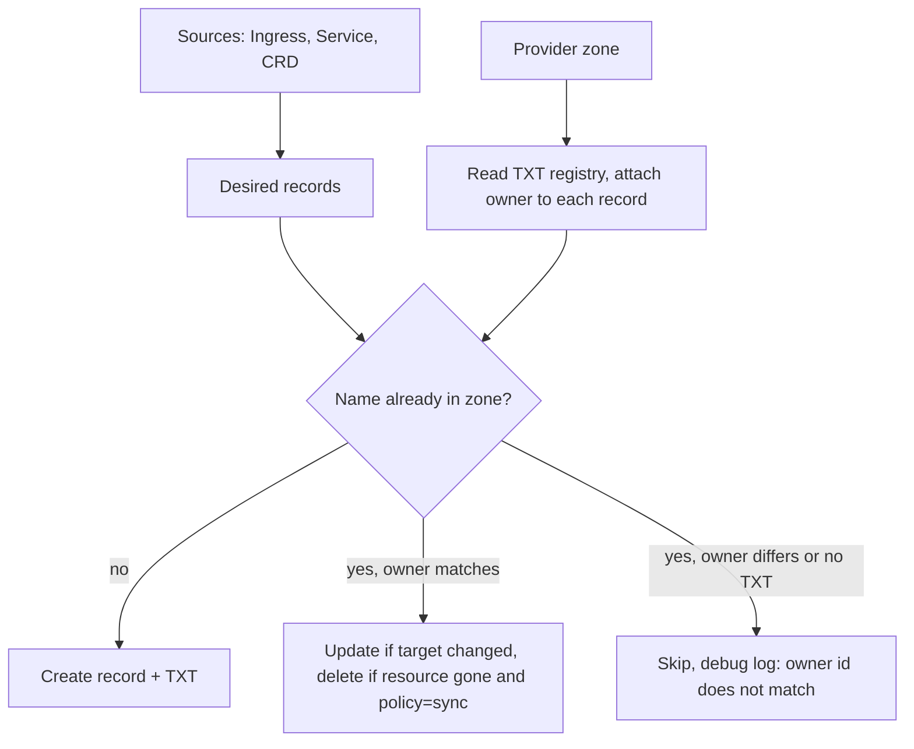

Exposing a service from a cluster ends with the same manual step every time: someone opens the DNS provider's dashboard and points a name at the load balancer. The Ingress is in git, the certificate is in git, the record is in a browser tab. ExternalDNS is the kubernetes-sigs controller that moves that last step into the cluster. The setup is one Deployment. The part that deserves real attention is how it decides which records it is allowed to touch, because that is the only thing standing between you and a sync loop that empties a zone.

## What it watches and where the hostname comes from

ExternalDNS is not a DNS server. It reads Kubernetes resources, works out which DNS names they want, and calls a provider's API to make the zone match. The resources it reads are called sources, chosen with `--source`, and the list is long: `service`, `ingress`, the Gateway API routes (`gateway-httproute`, `gateway-grpcroute`, `gateway-tlsroute`, `gateway-tcproute`, `gateway-udproute`), `istio-gateway` and `istio-virtualservice`, `traefik-proxy` for Traefik's IngressRoute CRDs, `crd` for a DNSEndpoint object you write by hand, plus Contour, Gloo, Kong, OpenShift routes, and a few more.

For an Ingress you do not have to annotate anything. The source walks `spec.rules[].host` and `spec.tls[].hosts` and takes every non-empty name it finds.

```yaml
apiVersion: networking.k8s.io/v1
kind: Ingress
metadata:
  name: app
  annotations:
    cert-manager.io/cluster-issuer: letsencrypt
spec:
  ingressClassName: traefik
  rules:
    - host: app.example.com
      http:
        paths:
          - path: /
            pathType: Prefix
            backend:
              service:
                name: app
                port:
                  number: 80
  tls:
    - hosts: [app.example.com]
      secretName: app-tls
```

A Service of type LoadBalancer has no host field, so the name goes in an annotation:

```yaml
apiVersion: v1
kind: Service
metadata:
  name: mqtt
  annotations:
    external-dns.kubernetes.io/hostname: mqtt.example.com
    external-dns.kubernetes.io/ttl: "120"
spec:
  type: LoadBalancer
  selector:
    app: mqtt
  ports:
    - port: 1883
```

The same annotation works on an Ingress when you want names beyond the ones in the rules, and it takes a comma-separated list.

One thing to check before copying from an older tutorial: the prefix. Every release before v0.22.0 used `external-dns.alpha.kubernetes.io/`. From v0.22.0 the default is `external-dns.kubernetes.io/`, with no fallback, and the release notes say outright that this change can delete all your DNS records, since an instance running `--policy=sync` stops seeing the old annotations and concludes the records are no longer wanted. If you upgrade with the old prefix in place, pass `--enable-legacy-annotation-prefix` so both are read, or set `--annotation-prefix=external-dns.alpha.kubernetes.io/` to keep the old one, then migrate the manifests.

## The provider is a flag, not an annotation

I wanted to know whether the annotation picks the provider. It does not. The annotation carries the DNS name. The provider is set once, on the controller, and so is everything that scopes what it may touch:

```yaml
containers:
  - name: external-dns
    image: registry.k8s.io/external-dns/external-dns:v0.23.0
    args:
      - --provider=cloudflare
      - --source=ingress
      - --source=service
      - --domain-filter=example.com
      - --registry=txt
      - --txt-owner-id=hetzner-prod
      - --policy=upsert-only
    env:
      - name: CF_API_TOKEN
        valueFrom:
          secretKeyRef:
            name: cloudflare-api-token
            key: token
```

The Cloudflare tutorial's example token has Zone Read and DNS Edit on all zones. Grant those on the one zone in `--domain-filter` instead. `--domain-filter` is a suffix match and can be repeated. If you also pass `--zone-id-filter`, the provider is pinned to the zone IDs you list on top of that. Both flags stop ExternalDNS from looking at records in other zones; the token is what stops it being able to change them if a flag goes missing.

`--policy` has to be there. Before v0.22.0 it defaulted to `sync`, and that release made it required with no default, for the same reason the prefix change was dangerous. More on the two values further down.

Cloudflare, Route53, Google Cloud DNS, Azure DNS, RFC2136, PowerDNS and a dozen others are in-tree. Newer providers, Hetzner DNS included, are webhook providers: a separate container that speaks ExternalDNS's provider API on one side and the vendor's API on the other. The README says the maintainers have not reviewed those providers and you use them at your own risk. That is not a reason to avoid them, but it is a reason to read the webhook's issue tracker before putting it in front of production DNS.

## A or CNAME: the target decides

I also wanted to know where to choose between an A record and a CNAME. You don't. ExternalDNS takes the target from `status.loadBalancer.ingress` on the Ingress or Service, and the shape of the target decides the type. An IPv4 address becomes an A record, an IPv6 address an AAAA, and anything else a CNAME. A Hetzner load balancer or MetalLB puts an IP in status, so you get an A record. An AWS ELB puts a hostname there, so you get a CNAME. On Route53 that CNAME is turned into an ALIAS record instead, unless you pass `--aws-prefer-cname`, and the `external-dns.kubernetes.io/alias` annotation controls it per resource.

You can override the target entirely:

```yaml
external-dns.kubernetes.io/target: 203.0.113.10
```

Same rule applies: an IP gives an A record, a hostname gives a CNAME. This is the escape hatch when the Ingress controller does not publish an address into status, or when you want every name to point at a fixed front door regardless of what the controller reports.

For Cloudflare there is one more annotation, `external-dns.kubernetes.io/cloudflare-proxied: "true"`, which turns the orange cloud on for that record. The `--cloudflare-proxied` flag sets the default for all of them.

The only place you write a record type by hand is the DNSEndpoint CRD. It exists for records that have no Kubernetes resource behind them, and it goes through the same ownership registry as everything else:

```yaml
apiVersion: externaldns.k8s.io/v1alpha1
kind: DNSEndpoint
metadata:
  name: legacy-mail
spec:
  endpoints:
    - dnsName: mail.example.com
      recordType: A
      recordTTL: 300
      targets:
        - 198.51.100.25
    - dnsName: www.example.com
      recordType: CNAME
      recordTTL: 300
      targets:
        - example.com
```

It needs `--source=crd` and the CRD installed from `config/crd/standard/dnsendpoints.externaldns.k8s.io.yaml` in the repo. By default ExternalDNS only manages A, AAAA, and CNAME; an NS or SRV endpoint is ignored until you add it with `--managed-record-types`.

## The TXT record is the ownership model

With `--registry=txt`, which is the default, ExternalDNS writes a companion TXT record next to every record it creates. The TXT holds something like:

```
"heritage=external-dns,external-dns/owner=hetzner-prod,external-dns/resource=ingress/default/app"
```

The owner is your `--txt-owner-id`. The TXT name has carried the record type as a prefix since v0.12, v0.16 wrote both the bare name and the prefixed one, and since v0.18 the prefixed name is the only form written. So the registry record for an A record at `app.example.com` is `a-app.example.com`, and for a CNAME it is `cname-app.example.com`. The prefix exists so that an A and an AAAA at the same name can each have their own registry record, and it also gets around the rule that a CNAME cannot share its name with any other record, which made a TXT at the bare name impossible for CNAMEs. `--txt-prefix` and `--txt-suffix` add your own string on top, and the docs are explicit that you should not change them after deployment, because the existing registry records become orphaned and the metadata is lost.

Every reconcile does the same thing. Build the desired records from the sources, list the zone from the provider, read the TXT records to attach an owner to each existing record, then compare.



What happens if I create `app.example.com` in the Cloudflare dashboard first and then add an Ingress for it? ExternalDNS sees the record, finds no TXT with its owner ID, and does nothing. It will not overwrite or delete it, and it will not adopt it either. The plan code is specific about this: updates and deletes are filtered down to records with a matching owner, and a create for a name that already has an unowned record is dropped. The message it logs is `Skipping endpoint ... because owner id does not match for one or more items to create`, and it only logs at debug level, so at the default log level the record just quietly never changes. If an Ingress is "not getting its record", start by running with `--log-level=debug`.

To hand a manual record over, delete it at the provider and let the next reconcile recreate it with its TXT. There is a `--migrate-from-txt-owner` flag for moving records between owner IDs, but the docs warn that combined with `policy=sync` in a shared zone it can delete records another cluster still owns. For a handful of records, delete and recreate is less exciting.

Three rules fall out of this.

The TXT records are the registry. Delete one by hand and ExternalDNS stops managing that record, with no error, until you also delete the record and let it be recreated.

Every cluster that writes to the same zone needs its own `--txt-owner-id`. The default value is literally `default`, so two clusters that both skip the flag share an owner, and each one treats the other's records as its own to correct or delete. The README asks for a value that is unique and does not change for the lifetime of the cluster. A region plus an environment name is enough.

And the ownership check protects records, not names. Nothing stops a developer in a second cluster from putting `app.example.com` on their Ingress. ExternalDNS there will skip it as unowned, log at debug, and the developer will wonder why DNS is broken. Scoping each cluster's token and `--domain-filter` to its own zone or subdomain is what prevents the collision; the registry only makes it harmless.

## Before you turn on sync

`--policy=upsert-only` creates and updates records and never deletes anything. `--policy=sync` also deletes a record when the resource behind it disappears. `create-only` is the third option, for the rare case where you want a record written once and never touched again.

Sync is the correct end state, because a stale record pointing at a load balancer that no longer exists is the exact problem the tool is for. It is also the setting that deletes things. Under ArgoCD with automated pruning, deleting an Ingress from git prunes the Ingress, and ExternalDNS deletes the record a minute later. That is the behaviour you asked for. The same chain runs when the prune is a mistake: a wrong branch, or a values file that templated zero Ingresses. Both produce an empty desired state and, with sync, a zone with every owned record removed.

The order that works: start on `upsert-only` with `--dry-run` and read what it would do, drop `--dry-run` once the planned changes look right, and switch to `sync` only after the owner ID, the domain filter, and the token scope are settled. The flag is cheap to flip. The records are not cheap to recreate from memory.

## When the DNS provider has no API

ExternalDNS, including every webhook provider, needs something to call. A registrar that only offers a web form is a dead end, and adapters that script the dashboard break the day the dashboard changes.

The usual fix is to move DNS hosting and keep the registrar. Point the nameservers at Cloudflare, Route53, or Hetzner DNS and run ExternalDNS there.

If the root zone has to stay where it is, delegate a subdomain. Add NS records at the old provider for `k8s.example.com` pointing at the new host's nameservers, create the `k8s.example.com` zone there, and run ExternalDNS with `--domain-filter=k8s.example.com`. One manual change, done once, and everything under that subdomain is automated. Most providers let you add NS records from the dashboard even with no API.

If the authoritative server is yours, BIND or anything else that accepts RFC 2136 dynamic updates, the in-tree `rfc2136` provider sends DNS UPDATE messages signed with a TSIG key. No REST API, just the DNS protocol. It needs `--rfc2136-axfr` so it can transfer the zone to list and delete records, and the docs say it was developed for and tested with BIND, with Microsoft DNS workable but not tested.

And sometimes the honest answer is to skip ExternalDNS. One manual wildcard, `*.example.com` pointing at the ingress controller's load balancer, makes every hostname resolve to Traefik, which routes by Host header from there. If the load balancer IP is fixed, as it usually is on Hetzner, that record never goes stale. The cost is that every name points at the same place, including typos, and a Service that needs its own load balancer gets nothing.

