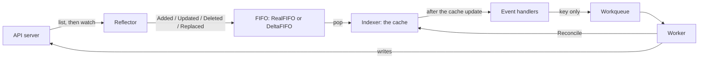

## `kubectl apply` returns before anything runs

You run `kubectl apply -f deployment.yaml`. kubectl sends the Deployment to the API server. The API server validates the object and writes it to etcd. kubectl prints `deployment.apps/web created`. At this point no Pod exists, and no node has pulled an image. The only change is one record in etcd.

The Pods appear because a controller makes them appear. The Deployment controller runs inside kube-controller-manager and holds an open watch on Deployments. It sees the new object, compares the spec with the ReplicaSets that exist, and creates one. The ReplicaSet controller sees the new ReplicaSet and creates the Pods. The scheduler sees Pods with no node and assigns one. The kubelet on that node sees a Pod with its node name and starts the containers.

The API server does not call any of these components. Each one connects to the API server, reads the objects that it watches, and acts on what it finds. This is a pull model. A controller is a client of the API server, with the same `list` and `watch` verbs that kubectl uses.

The Kubernetes docs describe the Job controller in the same way. It does not run Pods itself. It tells the API server to create or remove them.

Everything in Kubernetes that looks automatic is one of these loops. When you see how the informer feeds the loop, you can read the source of any controller, and you can write your own.

## Level-triggered, not edge-triggered

A controller does not react to "what changed". It reacts to "this object may need work". The reconcile reads the whole object and the whole state of the world, and then it corrects the difference. The controller-runtime godoc for `Reconciler` says this directly: reconciliation is level-based, and individual events do not drive the action. The `Request` that a reconcile receives contains a namespace and a name, and nothing about the event.

There are good reasons for this design. When the controller restarts, the informer lists every object again, and each object arrives as an add with no history. When a watch stays down for longer than the API server keeps history, the client gets `410 Gone` and must list again. The queue merges ten edits into one key, so the reconcile sees the last state and not the ten steps. By default, controller-runtime also sends every cached object to the handlers again every ten hours, as an update with no change in it.

Because of this, the reconcile cannot trust a diff. It must be idempotent. If you run it twice on the same state, the second run changes nothing. This is what makes the retry safe. A reconcile that fails halfway can run again from the start, because the start is always "read everything, then fix the difference".

## The reconcile loop, in code

The loop below is in controller-runtime style, with an example `Widget` kind that owns one external resource. The comments mark the steps. The text after the code explains each return value.

```go
func (r *WidgetReconciler) Reconcile(ctx context.Context, req ctrl.Request) (ctrl.Result, error) {
	const finalizer = "widget.example.com/finalizer"

	// 1. Read the object. r.Get reads the informer cache, not the API server.
	var w examplev1.Widget
	if err := r.Get(ctx, req.NamespacedName, &w); err != nil {
		// NotFound: the object is gone and there is nothing to do.
		// A nil error tells the queue to forget the key.
		return ctrl.Result{}, client.IgnoreNotFound(err)
	}

	// 2. The object is being deleted. Clean up, then let it go.
	if !w.DeletionTimestamp.IsZero() {
		if controllerutil.ContainsFinalizer(&w, finalizer) {
			if err := r.deleteExternal(ctx, &w); err != nil {
				return ctrl.Result{}, err // retried with backoff, finalizer stays
			}
			controllerutil.RemoveFinalizer(&w, finalizer)
			if err := r.Update(ctx, &w); err != nil {
				return ctrl.Result{}, err
			}
		}
		return ctrl.Result{}, nil
	}

	// 3. Add the finalizer before anything external exists.
	if !controllerutil.ContainsFinalizer(&w, finalizer) {
		controllerutil.AddFinalizer(&w, finalizer)
		if err := r.Update(ctx, &w); err != nil {
			return ctrl.Result{}, err
		}
	}

	// 4. Compare the spec with the world and make one change.
	actual, err := r.observe(ctx, &w)
	if err != nil {
		return ctrl.Result{}, err
	}
	if actual == nil {
		id, err := r.createExternal(ctx, &w)
		if err != nil {
			return ctrl.Result{}, err
		}
		w.Status.ID = id
		// Come back in one second to observe the new resource. Do not depend on
		// the status update event for that, because a predicate may drop it.
		return ctrl.Result{RequeueAfter: time.Second}, r.Status().Update(ctx, &w)
	}

	// 5. Record what you saw. Status is the controller's own record.
	w.Status.State = actual.State
	if err := r.Status().Update(ctx, &w); err != nil {
		return ctrl.Result{}, err
	}

	// 6. Nothing to do now. Check again later.
	return ctrl.Result{RequeueAfter: time.Minute}, nil
}
```

Each return value tells the queue something different. The rules below come from `pkg/internal/controller/controller.go` in controller-runtime v0.23.0.

`ctrl.Result{}, nil` means the work is done. The controller calls `Forget` on the key, which resets the backoff counter, and the key leaves the queue. The reconcile does not run again until a new event adds the key.

`ctrl.Result{RequeueAfter: d}, nil` means the work is done for now. The controller calls `Forget` and then adds the key again after the duration `d`. KubeProvisioner ends its create path with `RequeueAfter: 1 * time.Second`, so the next reconcile checks the new instance in AWS one second later.

`ctrl.Result{}, err` means the work is not done. The controller logs the error, counts it in the metrics, and adds the key back with rate limiting. The per-key backoff grows with each failure and resets on the next success. The controller ignores the `Result` when the error is not nil. If the error is a `reconcile.TerminalError`, the controller logs it and does not add the key back.

`ctrl.Result{Requeue: true}, nil` also adds the key back with rate limiting. v0.23.0 marks the `Requeue` field as deprecated, and the godoc says to use `RequeueAfter` instead.

## Where the object comes from: the informer

The reconcile calls `r.Get`. That call does not go to the API server. It reads a local cache that an informer keeps current. The informer is the part of client-go that turns the API server's `list` and `watch` into that cache, plus a stream of events.

The informer starts with a list. The reflector requests every object of one kind and keeps the `resourceVersion` from the list response. Then it opens a watch from that `resourceVersion`. The API server streams every change after that point, so the reflector misses nothing between the list and the watch. If the connection drops, the reflector opens a new watch from its last `resourceVersion`. The reflector also asks for `BOOKMARK` events, which carry only a `resourceVersion`, so a quiet watch can still move its position forward.

The reflector does not write to the cache directly. It pushes each change from the watch into a FIFO as one delta. In client-go v0.35.0 that FIFO is a `RealFIFO` by default, behind the `InOrderInformers` feature gate, and it delivers every delta in order. With the gate off, the informer uses the older `DeltaFIFO`, which merges the pending deltas for one object into one list. The informer pops from the FIFO, applies the delta to the cache, and only then calls the event handlers.

The order matters. The client-go godoc says that notifications happen after the corresponding cache update. A handler that reads the cache sees at least the state in the event.

The API server keeps watch history for a limited time, five minutes by default with etcd 3. A watch that asks for an older `resourceVersion` gets `410 Gone`. The reflector then lists again. The FIFO emits a `Replaced` delta for every object in the new list. It emits a `Deleted` delta for every cached object that the new list does not contain. The informer rebuilds the cache from the new list.

The cache is a client-go `Indexer`. It stores each object under its key, `namespace/name`, and keeps extra indices, by namespace by default. In controller-runtime, the manager's default client reads from this cache and sends writes directly to the API server. The manager starts an informer the first time a controller asks for a kind. That is why `r.Get` is cheap, and why a controller can read objects as often as necessary with no API call.



