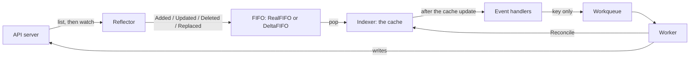

## `kubectl apply` returns before anything runs

You run `kubectl apply -f deployment.yaml`. kubectl sends the Deployment to the API server. The API server validates the object and writes it to etcd. kubectl prints `deployment.apps/web created`. At this point no Pod exists, and no node has pulled an image. The only change is one record in etcd.

The Pods appear because a controller makes them appear. The Deployment controller runs inside kube-controller-manager and holds an open watch on Deployments. It sees the new object, compares the spec with the ReplicaSets that exist, and creates one. The ReplicaSet controller sees the new ReplicaSet and creates the Pods. The scheduler sees Pods with no node and assigns one. The kubelet on that node sees a Pod with its node name and starts the containers.

The API server does not call any of these components. Each one connects to the API server, reads the objects that it watches, and acts on what it finds. This is a pull model. A controller is a client of the API server, with the same `list` and `watch` verbs that kubectl uses.

The Kubernetes docs describe the Job controller in the same way. It does not run Pods itself. It tells the API server to create or remove them.

Everything in Kubernetes that looks automatic is one of these loops. When you see how the informer feeds the loop, you can read the source of any controller, and you can write your own.

## Level-triggered, not edge-triggered

A controller does not react to "what changed". It reacts to "this object may need work". The reconcile reads the whole object and the whole state of the world, and then it corrects the difference. The controller-runtime godoc for `Reconciler` says this directly: reconciliation is level-based, and individual events do not drive the action. The `Request` that a reconcile receives contains a namespace and a name, and nothing about the event.

There are good reasons for this design. When the controller restarts, the informer lists every object again, and each object arrives as an add with no history. When a watch stays down for longer than the API server keeps history, the client gets `410 Gone` and must list again. The queue merges ten edits into one key, so the reconcile sees the last state and not the ten steps. By default, controller-runtime also sends every cached object to the handlers again every ten hours, as an update with no change in it.

Because of this, the reconcile cannot trust a diff. It must be idempotent. If you run it twice on the same state, the second run changes nothing. This is what makes the retry safe. A reconcile that fails halfway can run again from the start, because the start is always "read everything, then fix the difference".

## The reconcile loop, in code

The loop below is in controller-runtime style, with an example `Widget` kind that owns one external resource. The comments mark the steps. The text after the code explains each return value.

```go
func (r *WidgetReconciler) Reconcile(ctx context.Context, req ctrl.Request) (ctrl.Result, error) {
	const finalizer = "widget.example.com/finalizer"

	// 1. Read the object. r.Get reads the informer cache, not the API server.
	var w examplev1.Widget
	if err := r.Get(ctx, req.NamespacedName, &w); err != nil {
		// NotFound: the object is gone and there is nothing to do.
		// A nil error tells the queue to forget the key.
		return ctrl.Result{}, client.IgnoreNotFound(err)
	}

	// 2. The object is being deleted. Clean up, then let it go.
	if !w.DeletionTimestamp.IsZero() {
		if controllerutil.ContainsFinalizer(&w, finalizer) {
			if err := r.deleteExternal(ctx, &w); err != nil {
				return ctrl.Result{}, err // retried with backoff, finalizer stays
			}
			controllerutil.RemoveFinalizer(&w, finalizer)
			if err := r.Update(ctx, &w); err != nil {
				return ctrl.Result{}, err
			}
		}
		return ctrl.Result{}, nil
	}

	// 3. Add the finalizer before anything external exists.
	if !controllerutil.ContainsFinalizer(&w, finalizer) {
		controllerutil.AddFinalizer(&w, finalizer)
		if err := r.Update(ctx, &w); err != nil {
			return ctrl.Result{}, err
		}
	}

	// 4. Compare the spec with the world and make one change.
	actual, err := r.observe(ctx, &w)
	if err != nil {
		return ctrl.Result{}, err
	}
	if actual == nil {
		id, err := r.createExternal(ctx, &w)
		if err != nil {
			return ctrl.Result{}, err
		}
		w.Status.ID = id
		// Come back in one second to observe the new resource. Do not depend on
		// the status update event for that, because a predicate may drop it.
		return ctrl.Result{RequeueAfter: time.Second}, r.Status().Update(ctx, &w)
	}

	// 5. Record what you saw. Status is the controller's own record.
	w.Status.State = actual.State
	if err := r.Status().Update(ctx, &w); err != nil {
		return ctrl.Result{}, err
	}

	// 6. Nothing to do now. Check again later.
	return ctrl.Result{RequeueAfter: time.Minute}, nil
}
```

Each return value tells the queue something different. The rules below come from `pkg/internal/controller/controller.go` in controller-runtime v0.23.0.

`ctrl.Result{}, nil` means the work is done. The controller calls `Forget` on the key, which resets the backoff counter, and the key leaves the queue. The reconcile does not run again until a new event adds the key.

`ctrl.Result{RequeueAfter: d}, nil` means the work is done for now. The controller calls `Forget` and then adds the key again after the duration `d`. KubeProvisioner ends its create path with `RequeueAfter: 1 * time.Second`, so the next reconcile checks the new instance in AWS one second later.

`ctrl.Result{}, err` means the work is not done. The controller logs the error, counts it in the metrics, and adds the key back with rate limiting. The per-key backoff grows with each failure and resets on the next success. The controller ignores the `Result` when the error is not nil. If the error is a `reconcile.TerminalError`, the controller logs it and does not add the key back.

`ctrl.Result{Requeue: true}, nil` also adds the key back with rate limiting. v0.23.0 marks the `Requeue` field as deprecated, and the godoc says to use `RequeueAfter` instead.

## Where the object comes from: the informer

The reconcile calls `r.Get`. That call does not go to the API server. It reads a local cache that an informer keeps current. The informer is the part of client-go that turns the API server's `list` and `watch` into that cache, plus a stream of events.

The informer starts with a list. The reflector requests every object of one kind and keeps the `resourceVersion` from the list response. Then it opens a watch from that `resourceVersion`. The API server streams every change after that point, so the reflector misses nothing between the list and the watch. If the connection drops, the reflector opens a new watch from its last `resourceVersion`. The reflector also asks for `BOOKMARK` events, which carry only a `resourceVersion`, so a quiet watch can still move its position forward.

The reflector does not write to the cache directly. It pushes each change from the watch into a FIFO as one delta. In client-go v0.35.0 that FIFO is a `RealFIFO` by default, behind the `InOrderInformers` feature gate, and it delivers every delta in order. With the gate off, the informer uses the older `DeltaFIFO`, which merges the pending deltas for one object into one list. The informer pops from the FIFO, applies the delta to the cache, and only then calls the event handlers.

The order matters. The client-go godoc says that notifications happen after the corresponding cache update. A handler that reads the cache sees at least the state in the event.

The API server keeps watch history for a limited time, five minutes by default with etcd 3. A watch that asks for an older `resourceVersion` gets `410 Gone`. The reflector then lists again. The FIFO emits a `Replaced` delta for every object in the new list. It emits a `Deleted` delta for every cached object that the new list does not contain. The informer rebuilds the cache from the new list.

The cache is a client-go `Indexer`. It stores each object under its key, `namespace/name`, and keeps extra indices, by namespace by default. In controller-runtime, the manager's default client reads from this cache and sends writes directly to the API server. The manager starts an informer the first time a controller asks for a kind. That is why `r.Get` is cheap, and why a controller can read objects as often as necessary with no API call.



## From event to queue

The event handler is short on purpose. It does not pass the object to the controller. It computes the key, `namespace/name`, and adds that string to the queue. The object stays in the cache.

This is what a raw client-go handler and worker look like. The in-tree Deployment controller and the sample-controller use a similar shape.

```go
informer.AddEventHandler(cache.ResourceEventHandlerFuncs{
	AddFunc: func(obj interface{}) {
		if key, err := cache.MetaNamespaceKeyFunc(obj); err == nil {
			queue.Add(key)
		}
	},
	UpdateFunc: func(_, newObj interface{}) {
		if key, err := cache.MetaNamespaceKeyFunc(newObj); err == nil {
			queue.Add(key)
		}
	},
	DeleteFunc: func(obj interface{}) {
		// obj can be a DeletedFinalStateUnknown tombstone. This key func handles both.
		if key, err := cache.DeletionHandlingMetaNamespaceKeyFunc(obj); err == nil {
			queue.Add(key)
		}
	},
})

// One worker. Run as many of these as you want in parallel.
for {
	key, shutdown := queue.Get()
	if shutdown {
		return
	}
	if err := sync(key); err != nil { // sync reads the object from the indexer by key
		queue.AddRateLimited(key)
	} else {
		queue.Forget(key)
	}
	queue.Done(key)
}
```

The queue is `k8s.io/client-go/util/workqueue`. Its godoc lists four properties. Three of them matter here.

- It is fair. Keys come out in the order in which they enter.
- It is stingy. If the handler adds a key several times before a worker takes it, the worker processes it once. Two workers never process one key at the same time.
- It accepts a key that a worker already holds. The queue marks that key dirty and adds it back when the worker calls `Done`.

The second property removes the duplicates. Ten quick edits to one object produce ten events and one reconcile.

The rate limiting is a separate layer. A worker calls `AddRateLimited` after a failure instead of `Add`. The default limiter in client-go v0.35.0 takes the larger of two delays. One is a per-key exponential backoff that starts at 5 ms, doubles on each failure, and stops at 1000 s. The other is an overall token bucket at 10 per second with a burst of 100. `Forget` resets the backoff counter.

In controller-runtime v0.23.0, the default queue is not the client-go queue. The default is a priority queue that controller-runtime provides. That queue keeps the per-key exponential backoff, 5 ms to 1000 s, and drops the token bucket. Set `UsePriorityQueue: false` in `controller.Options` to get the client-go queue back. Both queues remove duplicates, and both give one key to one worker at a time.

The reconcile reads the cache again instead of the event payload. There are three reasons.

- The payload can be older than the cache, because the informer may apply more deltas before the handler runs.
- The queue merges several events, so the payload is one of several states.
- The handler may add the key again while the reconcile runs.

The key only identifies the object. The cache holds the current state.

## Workers and concurrency

`MaxConcurrentReconciles` sets the number of workers for one controller. It defaults to 1. On `Start`, the controller launches that many goroutines, and each one loops on `processNextWorkItem`. A comment in `Start`, above that loop, states one rule: the worker never calls the reconcile handler concurrently for the same object.

That guarantee comes from the queue, not from the controller. The queue keeps a set of keys in process. The queue does not give a key in that set to a second worker. If the same key arrives while a worker holds it, the queue waits, then hands the key out again after `Done`. So two reconciles for `default/web` never overlap. Reconciles for `default/web` and `default/api` run in parallel when you have two workers.

Leader election solves a different problem: two replicas of the same binary. Without it, both replicas run the controller, and both write to the API server. The controller-runtime manager takes `LeaderElection: true` and a `LeaderElectionID`, and uses a Lease object as the lock by default. Only the replica that holds the lease starts the controllers. If the leader loses the lease, `Start` returns, and the godoc says the binary must exit at once. KubeProvisioner creates its manager with `LeaderElectionID: "c56fc483.cloud.com"`, and its `--leader-elect` flag defaults to false.

The client-go `leaderelection` godoc adds one caution. The implementation does not guarantee that only one client acts as leader. It relies on local timestamps and on the lease duration. Make sure your reconcile is idempotent even with leader election on.

## Status, finalizers, and owner references

Status is the controller's own record of the world. The spec is what the user wants. The status is the controller's last observation. KubeProvisioner's `Ec2Instance` status holds `InstanceID`, `State`, `PublicIP`, `PrivateIP`, `PublicDNS`, `PrivateDNS`, and `LaunchTime`. The README shows three of them, `State`, `PublicIP`, and `InstanceID`, as columns in `kubectl get ec2instances -w`.

When you enable the status subresource on a CRD, the object gets a separate `/status` endpoint. With the subresource on, a `PUT`, `POST`, or `PATCH` to the main endpoint ignores changes to the status stanza. A `PUT` to `/status` ignores changes to everything except the status stanza. `metadata.generation` increments for all changes except changes to `.metadata` or `.status`, so a status write does not change the generation.

RBAC treats a subresource as its own resource name. The kubebuilder markers in KubeProvisioner grant `ec2instances/status` with `get;update;patch` in a separate rule from `ec2instances`. That split lets you give a user write access to the spec and no write access to the status.

A finalizer is a string in `metadata.finalizers` that says "do not let this object disappear until I have cleaned up". When you delete an object with a finalizer, the API server sets `metadata.deletionTimestamp`, returns `202 Accepted`, and keeps the object. The delete is now an update. The controller sees the update, does its cleanup, removes its finalizer, and writes the object. When the list is empty, the API server removes the object. Once the timestamp exists, nobody can add a new finalizer, and nobody can bring the object back.

KubeProvisioner uses the finalizer `ec2instance.compute.cloud.com`, and the controller appends it on the first reconcile. When the object has a `DeletionTimestamp`, the controller calls `deleteEc2Instance`, then `controllerutil.RemoveFinalizer`, then `r.Update`. If the AWS call fails, the controller returns the error and the finalizer stays. The object then stays too, and the next reconcile tries again. The Kubernetes docs ask for a qualified name with a slash, such as `example.com/finalizer-name`. Use that form in a new controller.

Owner references are the other cleanup path, for objects inside the cluster. A ReplicaSet carries an `ownerReferences` entry that points at its Deployment, and each Pod points at its ReplicaSet. When you delete the owner, the garbage collector deletes the dependents, in the background by default. The reference with `controller: true` marks the one controller that manages the object. `controllerutil.SetControllerReference` writes that entry for you. Owner references do not cross namespaces, and the docs say that the garbage collector treats an invalid cross-namespace reference as absent.

## Watching more than your own kind

A controller for one kind usually has to run a reconcile when a related kind changes. The Deployment controller has to react when one of its ReplicaSets changes, or a rollout would stall. In kube-controller-manager, `NewDeploymentController` registers handlers on three informers: Deployments, ReplicaSets, and Pods. The ReplicaSet handlers read the controller reference on the ReplicaSet, resolve the Deployment, and add the Deployment's key to the queue. The reconcile for the Deployment then reads its ReplicaSets from the cache.

The controller-runtime builder gives you the same thing.

```go
func (r *WidgetReconciler) SetupWithManager(mgr ctrl.Manager) error {
	return ctrl.NewControllerManagedBy(mgr).
		For(&examplev1.Widget{}).
		Owns(&appsv1.Deployment{}).
		Watches(&corev1.ConfigMap{}, handler.EnqueueRequestsFromMapFunc(r.widgetsForConfigMap)).
		WithOptions(controller.Options{MaxConcurrentReconciles: 4}).
		Complete(r)
}
```

`For` is the root kind. The godoc says it is the same as a `Watches` on that kind with `handler.EnqueueRequestForObject`, which adds the key of the object in the event. `Owns` watches a kind that your controller creates. Its default handler is `EnqueueRequestForOwner` with `OnlyControllerOwner`, so a change to a Deployment adds the key of the Widget named in the controller reference.

`Watches` takes any handler. `EnqueueRequestsFromMapFunc` runs your function on the object and adds every key it returns. That is how a ConfigMap change causes a reconcile for each Widget that reads it.

All controllers in one manager share one cache. The manager holds one informer per kind, and each controller adds its handlers to that informer. If three controllers watch Pods, there is one watch on Pods and one copy of each Pod in memory. An `Owns` on a common kind adds a handler, not a second watch. The client-go godoc notes that the informer delivers events to one handler in order, but it does not coordinate between different handlers.

## What controller-runtime hides from you

Each piece of the raw client-go controller maps to one piece of what kubebuilder scaffolds. This table lets you read in either direction.

| Raw client-go | controller-runtime / kubebuilder |
| :-- | :-- |
| Reflector, FIFO, Indexer, together as a `SharedIndexInformer` | The manager's `cache.Cache`, one informer per kind, started on first use |
| A lister or `indexer.GetByKey` | `r.Get` and `r.List` through the manager's client |
| `cache.ResourceEventHandlerFuncs` plus `MetaNamespaceKeyFunc` | `For`, `Owns`, `Watches` with a `handler.EventHandler` |
| `workqueue.NewTypedRateLimitingQueue` | The controller's queue: `priorityqueue` by default in v0.23.0, or the client-go queue with `UsePriorityQueue: false` |
| `for i := 0; i < workers; i++ { go worker() }` | `MaxConcurrentReconciles` |
| `syncHandler(key)` and `handleErr` | `Reconcile(ctx, req)` and the `Result` and error rules above |
| `cache.WaitForCacheSync` before the workers start | The manager waits for the caches before it starts a controller |
| `tools/leaderelection` set up by hand | `ctrl.Options{LeaderElection: true, LeaderElectionID: ...}` |

The kubebuilder scaffold puts the types in `api/v1` and a reconciler in `internal/controller`. The `cmd/main.go` file creates the manager and calls `SetupWithManager` for each reconciler. The RBAC rules come from the `+kubebuilder:rbac` markers above `Reconcile`.

If you want to see what this looks like in real code, the EC2 reconciler in [KubeProvisioner](https://github.com/1Shubham7/KubeProvisioner) is about 100 lines. It is a learning-grade operator, not a product. It has three CRDs in the group `compute.cloud.com/v1`: `Ec2Instance`, `S3Bucket`, and `SqsQueue`. It uses controller-runtime v0.23.0 and client-go v0.35.0, and the README installs it with the Helm chart in `./dist/chart`. The reconcile, the finalizer, the status writes, and the `Result` values are all in `internal/controller/ec2instance_controller.go`.

## Things that bite

**The cache is stale right after a write.** You call `r.Update`, return, and the next reconcile starts before the informer has received the new version. `r.Get` returns the old object.

The controller-runtime FAQ gives two defences. Use deterministic names for objects you create, so the API server rejects the duplicate. When that is not possible, keep a record of each write. Check that record on the next reconcile. Write the controller as if the cache is correct but a little behind, because that is what it is.

**Your own status update is an event.** Every `r.Status().Update` that changes something sends an update through the informer, and the handler adds your key to the queue again. One extra reconcile per write is fine when the reconcile is idempotent. A reconcile that writes a changing value on every reconcile, for example a timestamp, never stops.

Write the status only when a field changes. Or filter updates with `predicate.GenerationChangedPredicate`. That predicate drops updates where `metadata.generation` has the same value.

**`Requeue: true` together with a returned error.** The error takes priority: the controller ignores the `Result` and adds the key with rate limiting. It also logs a warning: `RequeueAfter and Requeue will always be ignored if the error is non-nil`. KubeProvisioner's delete path returns `ctrl.Result{Requeue: true}, err`, and the behaviour is the same as `ctrl.Result{}, err`. Version 0.23.0 of controller-runtime deprecates the field. Return an empty `Result` with the error.

**Create calls are not idempotent.** A reconcile can run twice for one object. The process can stop after it creates an external resource and before it records the ID. KubeProvisioner checks `Status.InstanceID` before it creates an instance. A second reconcile with a recorded ID does not create a second instance. That reconcile calls `checkEC2InstanceExists` to confirm that the instance still exists in AWS.

The window between the AWS call and the status write is still open. Close it with an idempotency token on the create call. As an alternative, add a tag when you create the instance. Then search for the tag before you create a new one.

**Two controllers write the same field.** Each one sets the field to its own value, each write is an event for the other, and the two alternate forever. The symptom is a steady stream of updates on an object that nobody edits. The rule is one owner per field. `kubectl get -o yaml --show-managed-fields` shows the manager for each field. That is the fastest way to find the second writer.

## Ending notes

One design choice explains most of this post: the handler adds the key to the queue, never the object. Because the key carries no state, the reconcile must read the cache and accept any state it finds there. So the reconcile must be idempotent. An idempotent reconcile lets the queue merge events, retry with backoff, and resend everything after a restart. Every rule in this post about when the key goes back on the queue follows from that one choice.

If you read the sources, read them in this order:

1. The Kubernetes docs page on controllers, for the model.
2. The sample-controller, for the raw client-go pieces.
3. The controller-runtime godoc for `reconcile` and `controller`, for the `Result` rules.
4. One real reconciler, start to finish.

I hope this post was helpful, thanks for reading :)
