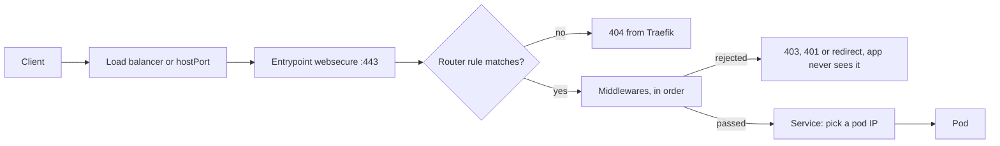

For about a year, Traefik was the thing I copied. A new app needed a hostname, so I took the Ingress from the last app, changed the host and the Service name, and it worked. It needed an IP allow-list, so I found a Middleware that did that on another cluster and pasted it in. Across the customer clusters I run at Obmondo this got me surprisingly far. Traefik is forgiving of people who do not read the docs, and I took full advantage of that.

Then I had to explain our setup to someone outside the team, and I could not get past the YAML. I could say what each object was called. I could not say what happened to a request between the load balancer and the pod, why one change to Traefik needed a rollout and another did not, or what the certificate in the Secret was actually for during the handshake.

So I went back and asked the questions I should have asked at the start. This post is those questions, in the order I asked them.

## Is Traefik just a reverse proxy like NGINX?

Yes. Same job. One entry point in front of many backends, routing on hostname and path, TLS handled in one place instead of in every app, policies like redirects and allow-lists applied centrally.

The difference is how it gets its configuration. Classic NGINX reads a config file at startup, and changes to that file do nothing until you send it a reload. The reload itself is clean: the master process checks the new file, starts new workers, and tells the old ones to finish their in-flight requests and exit. But somebody or something has to write the file and send the signal. Traefik has no file to write. It watches a source of truth, Docker or Kubernetes or a few others, and when that source changes it rebuilds its routing table in memory. The docs describe this as hot-reloaded with no request interruption or connection loss.

A concrete example makes the gap obvious. Say you are putting a blog container on a Docker host at `blog.example.com`, with HTTPS from Let's Encrypt.

With NGINX, the upstream points at the container, so its address goes into the config. Then a server block for the redirect, a server block for HTTPS, and certbot to get the certificate and edit the config for you:

```nginx
upstream blog {
    server 172.18.0.5:2368;
}

server {
    listen 80;
    server_name blog.example.com;
    return 301 https://$host$request_uri;
}

server {
    listen 443 ssl;
    server_name blog.example.com;
    ssl_certificate     /etc/letsencrypt/live/blog.example.com/fullchain.pem;
    ssl_certificate_key /etc/letsencrypt/live/blog.example.com/privkey.pem;

    location / {
        proxy_pass http://blog;
    }
}
```

Then `nginx -t && nginx -s reload`. Certbot's packaged renewal job runs `certbot renew` on a schedule, and you add a deploy hook so NGINX reloads when a renewal lands. When the container is recreated and comes up on a different IP, or when you scale it to two, you edit the upstream and reload again.

With Traefik on the same host, the per-app configuration is two labels on the container:

```yaml
services:
  blog:
    image: ghost:5
    labels:
      traefik.http.routers.blog.rule: Host(`blog.example.com`)
      traefik.http.routers.blog.tls.certresolver: le
```

The certificate resolver named `le` and the redirect from port 80 to 443 are set once on the Traefik instance, not per app. Traefik sees the container start through the Docker socket, reads the labels, picks the first port the image exposes, requests a certificate, and starts routing. Recreate the container and the new IP is picked up. Scale it and both replicas get traffic. Remove it and the route goes away.

Now the honest part. In Kubernetes the gap is much smaller than this example suggests, because ingress-nginx does exactly the wrapping I just described by hand. It watches Ingress objects, renders an `nginx.conf` from a template, and reloads NGINX when the config changes; it even skips the reload when only the endpoints behind an upstream change, by pushing the new list into a Lua handler inside NGINX. And cert-manager takes care of certificates for either controller: it talks to Let's Encrypt, stores the certificate and key in a Secret, and renews before expiry. In a cluster, both tools give you declarative routing and automatic certificates.

What remains is a difference in design. ingress-nginx is a reload-based proxy with an automation layer wrapped around it. Traefik is dynamic from the ground up; nothing in it works by regenerating a file. For most workloads you will not feel that day to day. It shows up in the edges: how often routes change, what a bad config does, how the provider model composes. Those are the next questions.

## Does all traffic in the cluster go through Traefik?

No, and I had this wrong for longer than I like to admit. The picture in my head was that the IP allow-list Middleware I had pasted in was a fence around the app. It is a fence around one door, and the app has others.

Traefik sees north-south traffic, and only the part of it that arrives at Traefik's own address. On a cloud cluster that is the load balancer in front of its Service. On one of our clusters it is the hostPort the DaemonSet binds on every node. Everything that reaches those ports goes through Traefik: web UIs, APIs, and the TCP traffic we route on purpose, like Git over SSH. Everything that does not reach those ports does not.

East-west traffic, pod to pod, never touches it. When the API pod calls the database Service, the request goes to a ClusterIP, kube-proxy or the CNI rewrites it to a pod IP, and it goes straight there. Traefik is not in that path and has no idea it happened. The same is true for a pod calling another pod's Service on port 80, which trips people up because it looks like HTTP traffic that "should" go through the ingress. It does not. A pod in the cluster that opens `grafana.monitoring.svc:3000` is this kind of caller, and the allow-list on Grafana's Ingress has no opinion about it.

A few more things bypass it even from outside. The Kubernetes API server has its own endpoint and its own port, and `kubectl` never goes near an ingress controller. An app with its own Service of type LoadBalancer or NodePort has its own door; an MQTT broker usually ends up this way. And host-level access, SSH to a node or an exporter on a host port, is the node's business, not the cluster's.

The practical consequence is that a Middleware on Traefik protects exactly one thing: requests that came in through Traefik. Anything that relies on Traefik for authentication needs a NetworkPolicy on the backend too, or the allow-list is decoration for anyone already inside the cluster.

## What actually happens to a request inside Traefik?

Traefik has four building blocks and every request passes through them in the same order. I had used all four for a year without being able to name that order.

An **entrypoint** is a named listening socket. `web` on `:80` and `websecure` on `:443` are the conventional pair, and the address syntax allows `/tcp` or `/udp` on the end. Things that belong to the socket live here: the redirect from `web` to `websecure` is an entrypoint option, and so is PROXY protocol, with a list of trusted IPs for the load balancer in front.

A **router** is a match rule attached to one or more entrypoints. The rule is an expression, `Host(`grafana.example.com`) && PathPrefix(`/api`)` and so on, and the router carries the TLS settings for the route. When several routers could match a request, priority decides, and the default priority is the length of the rule string. Longer rules win. That is a decent heuristic, since a more specific rule is usually a longer one, but it is only a heuristic, and a `HostRegexp` can outrank a plain `Host` it was never meant to beat. The `priority` field overrides it; `0` means "use the default", and negative values are allowed.

A **middleware** is a piece of request processing that runs between the router and the backend: redirects, header rewrites, IP allow-lists, forwardAuth, plugins. They are reusable, so one `office-only` middleware can hang off twenty routers. A `chain` middleware groups several into one name, which is how the mTLS header handling further down is attached with a single reference.

A **service** is the backend pool. In Kubernetes this is where Traefik does something ingress-nginx users do not expect: since v3.1 it watches EndpointSlices and sends traffic to the pod IPs directly, doing its own load balancing, rather than handing the request to the ClusterIP and letting kube-proxy pick. There is a `nativeLB` option to go through the Service instead, off by default. How Traefik connects to those pods is a separate object, a **ServersTransport**: whether to speak TLS to the backend, which CAs to trust, which server name to send, whether to skip verification, and the dial and response-header timeouts. Every service uses `default@internal` unless told otherwise.

Here is the IngressRoute form of a route with a middleware, which shows all four in one object:

```yaml
apiVersion: traefik.io/v1alpha1
kind: Middleware
metadata:
  name: office-only
  namespace: monitoring
spec:
  ipAllowList:
    sourceRange:
      - 203.0.113.0/24
---
apiVersion: traefik.io/v1alpha1
kind: IngressRoute
metadata:
  name: grafana
  namespace: monitoring
spec:
  entryPoints:
    - websecure
  routes:
    - match: Host(`grafana.example.com`)
      kind: Rule
      middlewares:
        - name: office-only
      services:
        - name: grafana
          port: 3000
  tls:
    secretName: grafana-tls
```

With a plain Ingress the same middleware is attached with an annotation, `traefik.ingress.kubernetes.io/router.middlewares: monitoring-office-only@kubernetescrd`. That `@kubernetescrd` suffix comes up again in the next question.



Two things in that diagram took me too long to internalise. If no router matches, the 404 comes from Traefik, not from your app. The docs are explicit: an unmatched request is a `404`, a `503` means a router matched but the service had no healthy servers, and a `502` means the upstream errored. The status code tells you which stage failed. And a middleware rejection ends the request right there. With forwardAuth, a 2xx from the auth server lets the original request through; anything else, and the auth server's response is what the client gets. The application never sees a request it was not allowed to see.

The dashboard shows all of this live. Enable `api.dashboard`, route a hostname to the `api@internal` service, and you get the routers, middlewares and services Traefik currently holds. Each name carries the provider that created it: `monitoring-office-only@kubernetescrd` came from a Middleware CRD, a name ending in `@kubernetes` came from a plain Ingress, `@file` from a file. When a route is missing or a middleware is not applied, the dashboard is the first place I look now, because it shows what Traefik built rather than what I think I wrote.

## Why do some changes need a restart and others don't?

Because Traefik has two kinds of configuration and reads them at different times.

**Static configuration** is read once, at startup. The current docs call it install configuration, which is a better name. It holds the entrypoints, the providers to watch, certificate resolvers for ACME, the API and dashboard switch, metrics and tracing, and plugin declarations. Change any of these and you are restarting the process. It can come from a file, from command-line arguments, or from environment variables, and the docs say those three are mutually exclusive and checked in that order.

**Dynamic configuration** is everything the providers feed in while Traefik runs: routers, middlewares, services, TLS options, certificates. This is the part that hot-reloads. Apply an Ingress and the route exists seconds later. Edit a TLSOption and the next handshake uses it. Rotate a CA bundle in a Secret and the next client certificate is checked against the new bundle, no restart.

In Kubernetes the split is visible in the pod. The Helm chart turns its values into container arguments, so the static configuration is literally `args`:

```yaml
providers:
  kubernetesCRD:
    enabled: true
  kubernetesIngress:
    enabled: true
    ingressClass: traefik-public
additionalArguments:
  - "--entrypoints.websecure.http.tls"
  - "--entrypoints.web.proxyprotocol.trustedips=10.0.0.0/8"
```

renders into `--providers.kubernetescrd`, `--providers.kubernetesingress.ingressclass=traefik-public`, the `additionalArguments` lines verbatim, and the `--entrypoints.<name>.address` flags the chart generates from `ports`. Change a value and Helm changes the pod spec, which rolls the Deployment. That is the restart. On a Deployment with two replicas it is uneventful. On a DaemonSet with hostPorts it is not, because a new pod cannot bind a port the old pod still holds, so the old one has to go first.

The providers are the interesting half of the static side. `kubernetesIngress` reads standard Ingress objects. `kubernetesCRD` reads Traefik's own IngressRoute, Middleware, TLSOption and friends. `kubernetesGateway` reads Gateway API resources. There is also `file`, `docker`, and a list of others. Several run at the same time in the same process, and every object is namespaced by the provider that produced it, which is where `@kubernetescrd` and `@file` come from. A middleware defined in a file can be referenced from an Ingress as `name@file`, and the Kubernetes namespace field is ignored in that cross-provider form.

On Gateway API: Traefik v3 implements it for real. The provider stopped being experimental in v3.1, the current docs state support for the Standard channel at v1.6.3, with HTTPRoute, GRPCRoute and TLSRoute, plus TCPRoute from the Experimental channel. You enable it with `providers.kubernetesGateway` and install the Gateway API CRDs yourself. It is one more provider in the same process, not a different product, which makes it a migration you can do one route at a time.

## What actually happens in a TLS handshake?

This is the section I wanted to write, because it is the one I was most wrong about. I knew that cert-manager put a certificate in a Secret and Traefik served it. I could not have told you which part of that was public, which part was secret, or where the key that encrypts the actual traffic comes from. The answer to the last one is the surprising one.

There are three different keys involved, and keeping them apart is most of the understanding:

| Thing | Who has it | What it is for |
| :-- | :-- | :-- |
| Certificate | Public, sent to every client | Carries the server's public key, the hostnames it is valid for (the SANs), and a CA's signature over all of that |
| Private key | Only the server, in the Secret's `tls.key` | Signs. Proves to the client that the server holds the key that matches the certificate |
| Session key | Both ends of one connection, nobody else | Symmetric key that encrypts the application data. Fresh per connection |

The certificate is public. Anyone can download it with `openssl s_client`. It proves nothing on its own; what proves something is a signature made with the private key, which the certificate lets the client verify.

Here is a first TLS 1.3 connection to `grafana.example.com`, step by step, as RFC 8446 describes it.

1. **TCP handshake.** SYN, SYN-ACK, ACK. One round trip before TLS says a word.
2. **ClientHello.** The client sends the TLS versions and cipher suites it supports, the server name it wants (`grafana.example.com`, the SNI extension), and a `key_share`: its half of a Diffie-Hellman exchange, already computed. In TLS 1.2 the client had to wait to learn which group the server wanted. In 1.3 the set of groups is small enough that the client just guesses and sends its share in the first message.
3. **ServerHello.** The server picks a cipher suite and sends its own `key_share`. At this moment both sides have what they need to compute the shared secret, and everything after the ServerHello is encrypted with keys derived from it.
4. **Diffie-Hellman.** Each side combines its own private value with the other's public share and arrives at the same secret. Nobody sent that secret over the wire. An observer who captured both key shares cannot compute it.
5. **Certificate.** The server sends its certificate chain. Encrypted, since we are past the ServerHello, which is one of the quiet improvements in 1.3: a passive observer no longer sees which certificate you got.
6. **CertificateVerify.** The server signs a hash of the entire handshake so far using its private key. This is the only thing the private key does in the whole connection. The client verifies the signature with the public key from the certificate, and if it checks out, the party on the other end holds the private key for `grafana.example.com`.
7. **Finished.** A MAC over the transcript, proving both sides saw the same handshake and nobody tampered with it.
8. **Client verification.** The client checks that the certificate's SANs include the name it asked for, that the chain leads to a CA it trusts, and that the dates are valid. Then it sends its own Finished.
9. **Application data.** HTTP, encrypted with the session key, which came out of step 4.

The insight that fixed my model is in steps 4 and 6. The certificate proves identity. The session key comes from Diffie-Hellman, and the certificate's key plays no part in computing it. This is why the handshake has forward secrecy: if someone records the traffic today and steals the private key next year, they can forge a server, but they cannot decrypt the recording, because the session key was never derived from the private key. In older TLS with RSA key exchange the client encrypted the secret with the certificate's public key and the private key decrypted it, so a stolen key exposed every past session. TLS 1.3 removed that mode entirely.

The second connection is a different story at each layer. Within one connection there is no second handshake at all; HTTP keep-alive and HTTP/2 multiplexing mean the browser sends dozens of requests over the one TLS session it already has. When it does open a new connection, the server has usually handed it a session ticket after the first handshake, a PSK the client can present in its next ClientHello. With a PSK, the server skips Certificate and CertificateVerify; the RFC is explicit that a server authenticating with a PSK sends neither. Identity was proven the first time, and the ticket is the receipt. A fresh Diffie-Hellman exchange usually still happens alongside the PSK, so resumed connections keep forward secrecy.

Then there is 0-RTT. With a PSK in hand, the client is allowed to send application data in its very first flight, before the server has replied at all. That saves a round trip, and it comes with two costs the RFC spells out: the early data is not forward secret, since it is encrypted only under keys derived from the PSK, and there is no guarantee against replay. An attacker who captures the first flight can send it again, and the server will process it twice. For a GET that is harmless. For a POST that moves money it is not, and the usual answer is to allow only idempotent requests over early data, or to leave it off.

Now back to Traefik, where every step above shows up as a field I had been copying.

SNI picks the certificate. In step 2 the client named the host, and Traefik uses that name to choose which certificate to present. Router rules have nothing to do with it; `Host()` is evaluated after the handshake is done. If no certificate matches the name, Traefik falls back to a default certificate, the self-signed one you get on a fresh install, unless `sniStrict` is on, in which case it refuses the connection. That is why a wrong hostname gets a certificate warning rather than a 404: the handshake failed before any router ran.

Termination versus passthrough is the question of who does steps 3 through 8. With termination, the normal case, Traefik does the handshake, holds the private key, and talks plain HTTP (or HTTPS over a ServersTransport) to the pod. With passthrough, on an IngressRouteTCP with `tls.passthrough: true`, Traefik reads the SNI from the ClientHello, which is unencrypted, picks a backend, and hands the raw bytes through. The backend holds the key and does the handshake. You lose everything that needs to see the request, every HTTP middleware included, and you keep the backend's end-to-end encryption.

TLSOption is where the handshake parameters live, and the one named `default` applies to every router that does not name another:

```yaml
apiVersion: traefik.io/v1alpha1
kind: TLSOption
metadata:
  name: default
  namespace: traefik
spec:
  minVersion: VersionTLS12
  sniStrict: true
```

`minVersion` sets the floor from step 2. Cipher suites are configurable for 1.2 and not for 1.3, where the docs say every supported suite is safe. `clientAuth` turns the handshake mutual, covered below. And `disableSessionTickets` does what it says: every client does a full handshake, steps 5 and 6 included, every time.

And the reason we run cert-manager rather than Traefik's built-in ACME. Traefik can get its own certificates from Let's Encrypt, and on a single Docker host it is the right tool. The catch is storage: the resolver writes everything to a file, `acme.json`, and the docs say plainly that running multiple Traefik instances with Let's Encrypt enabled is not supported, pointing to Traefik Enterprise or a certificate controller like cert-manager instead. `acme.json` is local to one process, and two replicas would have two of them. cert-manager puts the certificate in a Secret, every replica reads the same Secret, and the certificate resolver stays out of the static configuration entirely.

## Why do we run more than one Traefik in a cluster?

This one arrives in two framings, and the answer is the same.

The first is "how can two Traefiks both use 443?" A port is taken per IP, not per cluster. Each Traefik instance has its own Service, and a Service of type LoadBalancer gets its own external IP, so the public instance listens on 443 at one address and the internal instance listens on 443 at another. DNS decides which door a hostname goes to. The exception is hostPort: when Traefik binds 443 on the node itself, only one instance per node can have it. On the cluster where the public Traefik is a DaemonSet on hostPort 80 and 443, the internal one sits behind a ClusterIP Service and is reached over a NetBird VPN.

The second is "they both reach the same pods anyway, so what does the second one add?" It is about who can start a connection, not where it ends. Both instances can route to the same admin UI. Only one of them has an address the internet can reach. Internal UIs sit on the instance that is reachable only over the VPN, and the public instance has no router for them at all. Not a router with a middleware in front. No router.

That distinction is the whole argument. A forgotten middleware on the public instance is an exposure; on the internal one it is reachable only by people already on the VPN. A CVE in an admin tool matters less when the tool is not on a public IP to begin with. Each instance gets configuration tuned for its audience. A traffic spike on the public side cannot starve the internal side. The two upgrade independently. And internal hostnames never appear in a public certificate's SAN list or a public DNS zone.

The mechanism is one flag. Each instance owns an IngressClass, `--providers.kubernetesingress.ingressclass=<name>`, and from then on that provider ignores every Ingress whose class is not its own. An Ingress chooses its door by setting `ingressClassName`. I wrote up [the full setup, values files included](https://1shubham7.blog/multiple-traefik-instances/) separately.

On the clusters I run, most have exactly that pair, public and internal. One production cluster runs three, public, private and protected, each on its own Hetzner load balancer.

## What else are we actually using Traefik for?

A quick tour of the parts that only made sense once the questions above were answered.

**mTLS with certificates that already exist.** Every server we manage already holds a certificate Puppet issued it. Instead of handing those servers API tokens, Traefik authenticates them with that certificate: a TLSOption with `clientAuth.clientAuthType: RequireAndVerifyClientCert` and the Puppet CA in `clientAuth.secretNames` makes step 6 run in both directions, so the client signs too. Then a chain of middlewares strips any client-supplied `X-Forwarded-Tls-Client-Cert-Info` header, so nobody can forge an identity, and `passTLSClientCert` adds the verified certificate's details as a header the application reads. The [mTLS post](https://1shubham7.blog/traefik-mtls-existing-certificates/) has the Secret, the TLSOption and the middlewares.

**A JWT plugin through Yaegi.** Traefik plugins are Go source, interpreted at runtime by Yaegi, declared once in the static configuration under `experimental.plugins` and then used like any other middleware. We run a fork of a JWT plugin that verifies a token from a cookie and passes the user and customer IDs on as headers, so each customer's Grafana shows only that customer's data without Grafana knowing anything about the token. That is a post of its own which I have not written yet.

**forwardAuth with Keycloak.** For tools with no login of their own, a forwardAuth middleware asks an auth service backed by Keycloak whether each request is allowed, sends unknown browsers to log in, and lets the rest through with a 2xx. One annotation per Ingress is the whole integration, written up in [the forwardAuth post](https://1shubham7.blog/traefik-forward-auth-sso/).

**Git over SSH.** SSH is not HTTP, so it goes through a dedicated entrypoint on its own port and an IngressRouteTCP with a `HostSNI(`*`)` rule, which is the form a non-TLS TCP router needs. TCP routers are checked before HTTP routers on a shared entrypoint, but a separate entrypoint keeps it simple.

**IngressRoute where priority matters, ServersTransport for legacy backends.** The handful of routes where longest-rule-wins is the wrong order are IngressRoutes with an explicit `priority`. And the legacy backends that need Traefik to talk to them in a particular way, HTTPS with their own CA or a specific server name, get a ServersTransport. Each is a few lines, and each was a mystery until I knew which stage of the request it belonged to.

## Ending notes

None of what I learned changed the YAML. The Ingresses look the same as they did a year ago. What changed is that I can read one and say what will happen: which entrypoint catches it, which router wins and why, which middleware can reject it, which pod IPs it can land on, and which certificate the client is shown before any of that runs. For me the TLS question did the most work, because half the Traefik fields I had been copying turned out to be handshake parameters with a Traefik name on them.

If you are a year into running Traefik by pattern-matching, start with the dashboard and a request that returned a status you did not expect. The code tells you which of the four stages produced it, and the rest of the questions follow from there.

Thanks for your time :)
